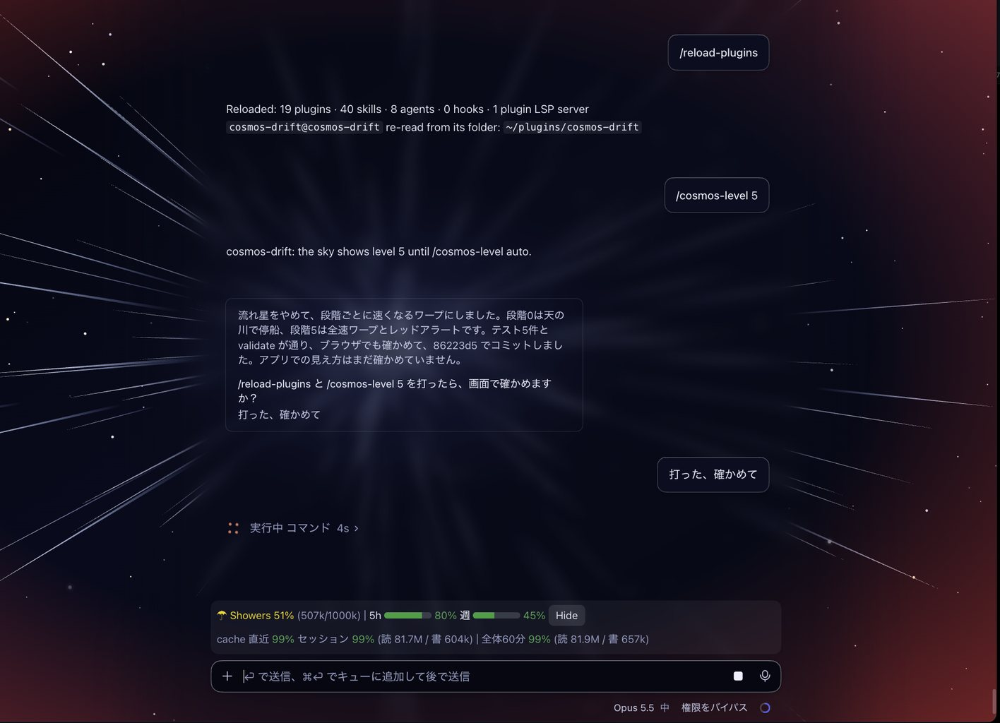
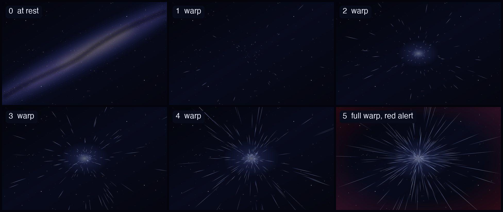

# cosmos-drift

[English](README.md)

Claude デスクトップアプリの Code タブ（とモバイルアプリ）を宇宙にする Claude Code の mod です。画面は墨のような紺に星明かりの青をアクセントにした色になり、背景には SVG のアニメーションが流れます。この背景は、コンテキストの使用量に合わせて変わります。余裕のあるうちは、天の川の下で停船中。埋まってくるとワープに入り、画面の中心から星が放射状に流れ出して、段階が上がるごとに速く、密になります。上限が近づくと、画面の縁が赤く明滅するレッドアラート。そろそろ新しいセッションを開け、の合図です。ターミナルとエディタはテーマを描かないので、そこでは何も起きません。



| コンテキストの使用量 | 段階 | 空のようす |
| --- | --- | --- |
| 40%未満 | 0 | 停船中。天の川と、またたく星 |
| 40〜59% | 1 | ワープ。光の筋60本、1本が中心から端まで3.2〜4.6秒 |
| 60〜74% | 2 | 100本、2.2〜3.2秒。進む先に青白い光 |
| 75〜84% | 3 | 150本、1.4〜2.1秒 |
| 85〜94% | 4 | 220本、0.9〜1.4秒 |
| 95%以上 | 5 | 全速ワープ。300本、0.55〜0.9秒。縁にレッドアラート |



段階は、モデルに問い合わせる直前（`turn.step`）と、ターンが終わったときに `$.session.usage()` から読みます。`/cosmos-level 0`〜`5` で段階を固定してお試しでき、`/cosmos-level auto` で使用量に合わせる動きに戻ります。

## 動作環境

- Claude デスクトップアプリ。空を描くのは Code タブです（モバイルアプリも描きます）。Claude Code 2.1.325、デスクトップアプリ 5.11492.5 で作って確かめました。古い版では、シーンの背景が使えないことがあります。ターミナルとエディタでも mod は動きますが、テーマは描かれません。
- ほかに要るものはありません。ビルドも、通信も、別のプログラムも不要です。

## 入れ方

Claude Code のメッセージ欄で：

```
/plugin install cosmos-drift --marketplace mlabo-org/cosmos-drift
```

マーケットプレイスを追加するか聞かれたら `y`、続けて入れる範囲を選びます。シェルから入れる場合は：

```bash
claude plugin install cosmos-drift --marketplace mlabo-org/cosmos-drift
```

新しいセッションでは自動で読み込まれます。開いているセッションには `/reload-plugins` で読み込みます。`/cosmos-level 5`（全速ワープ）で動作を確かめたら、`/cosmos-level auto` で戻してください。

## ファイル

- `hooks/register.tsx`：色と背景を設定し、コンテキストの使用量を追い、`/cosmos-level` に答え、`Backdrop` に `milky-way` のシーンを描きます。
- `hooks/scene.ts`：段階ごとのシーンを組み立てます。停船中は天の川、ワープ中は星空に光の筋・前方の光・レッドアラートを重ねます（停船中が約101,000文字、ワープ中が26,000〜70,000文字。シーンの上限は131,072文字）。
- `hooks/sky.ts`：生成した2つの空、`SKY`（天の川）と `SPACE`（ワープ用の星だけの空）。`tools/make_cosmos.py` で作り直せます（乱数の種を固定しているので、毎回同じ空になります）：`python3 tools/make_cosmos.py`
- `types/index.d.ts`：mod が持つ状態（`level`、`forced`）の型。
- `docs/`：この README の画像。`warp-in-app.jpg` は段階5のデスクトップアプリの画面、`levels.jpg` は、mod がアプリに渡すのと同じ SVG を Chrome で描いた各段階の空です。
- `cosmos.test.tsx`：`claude plugin test .` で、段階の区切り、文字数の上限、段階ごとにワープが速くなること、`/cosmos-level`、ターン中に加速することを確かめます。
- `hooks/make-colors.js` と `hooks/make-colors.d.ts`：Claude Code に入っている plugin-authoring スキルが、テーマ用の mod のために配っている色の補助ファイルです。手を加えずに写しています。Anthropic のもので、このプロジェクトの一部ではなく、このプロジェクトのライセンスの対象外です。

## 注意

- テーマは1セッションに1つです。あとから設定された別のテーマ mod に置き換わります。
- OS の「視差効果を減らす」がオンだと、星は止まり、ワープの筋は出ません。
- ダーク専用です。有効な間は、ダークモードで表示されます。
- デスクトップアプリでは、ワープはウィンドウではなくチャット画面の真ん中から放射します。アプリはサイドバーの下にも背景を描くので、中心をウィンドウの真ん中から94pt（サイドバーの幅の半分）右にずらしています（`hooks/scene.ts` の `DESKTOP_CENTRE_OFFSET`）。mod からはサイドバーが見えないため、サイドバーを閉じると、その分だけチャットより右に寄ります。モバイルアプリにはサイドバーがないので、ずらしません。
- テーマの mod は1つずつ使ってください。ほかのテーマ mod を外してから入れてください。あとで外した mod が、テーマを消してしまうためです。

## ライセンス

MIT です。ただし `hooks/make-colors.js` と `hooks/make-colors.d.ts` は対象外です（「ファイル」を参照）。
